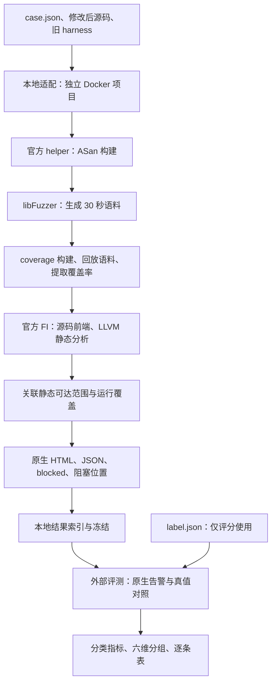

# Fuzz Introspector 实现方案：输入、分析流程、输出与判断指标

本文描述 `Fuzz_Introspector/` 中已经运行的实现，依据当前代码、固定版本的官方源码和本轮 Dataset-v9 结果整理。记录日期：2026-11-15。

## 1. 总体方法

**将“修改后的项目源码 + 旧 harness”构建为可运行的 fuzz target，用官方 Fuzz Introspector 分析其静态可达范围，再与实际运行得到的覆盖率对照，输出覆盖受阻提示和分析报告。最后，单独将官方告警与数据集维护标签对照，计算评测指标。**

这里包含三层工作：

| 层次 | 用什么 | 做什么 | 产生什么 |
|---|---|---|---|
| 数据与构建接入 | 本地 Python、Shell、Docker 适配代码 | 装载每条样本的源码与旧 harness，准备依赖，构建声明的 target | 独立项目上下文、目标程序、构建日志 |
| 官方分析 | OSS-Fuzz helper、libFuzzer、Clang/LLVM、Fuzz Introspector | 生成语料、采集覆盖率、分析调用关系和可达性、定位覆盖受阻位置 | 官方 HTML、JSON、调用树、覆盖数据、原生提示 |
| 外部评测 | `evaluate_native_alerts.py` | 将已冻结的原生 `blocked` 告警与维护真值对照 | TP/FP/TN/FN、Acc/P/Recall/FPR/FNR/F1、逐条表 |

**官方分析代码未修改。** 数据接入和外部评测是本地实验代码，不能将整个文件夹都称为官方原始实现。外部评测采用了“把原生 `blocked` 作为维护检出信号”的映射，但没有增加新的检测阈值、语义规则或模型。

这套实现没有 LLM、提示词、维护义务提取，也没有 `call/configuration/input/state/check` 通道匹配。它不从 diff 提取新义务，不恢复修改前版本，不输出“本次引入 / 非本次引入”。

## 2. 输入是什么

### 2.1 单条样本的分析输入

数据来源为工程根目录下的 `Dataset-v9/Dataset-v9/dataset/cases/`，读取主集样本，不纳入 `extension/`。

```text
<某条样本>/
├── case.json
├── input/
│   ├── source/          # 修改后的项目源码
│   ├── harness/         # 被测旧 harness、相关文件和构建材料
│   └── change.diff      # 随输入归档，本实现不据此做差分分析
└── label.json           # 只用于结果评测，不送入官方分析
```

| 输入 | 读取者 | 用途 |
|---|---|---|
| `case.json:id` | `run.py` | 标识样本、分配输出目录 |
| `project` | 构建适配器 | 选择项目构建入口与必要兼容项 |
| `harness_target` | 构建适配器、结果索引 | 确定被测目标，并关联官方 target profile |
| `harness_files`、`harness_location` | `entry.py` | 将旧 harness 放入项目内或 OSS-Fuzz 目标目录 |
| `build_script` | `entry.py`、`build_target.sh` | 定位原始构建材料，完成项目接入 |
| `input/source/` | 编译器、官方源码前端 | 构建程序，提取函数与调用信息 |
| `input/harness/` | 编译器、官方分析器 | 提供当前被测的旧 fuzz driver 及依赖文件 |
| `input/change.diff` | 仅随 `input.tar` 保存 | 当前官方流程不读取它来判断维护缺口 |

构建时保持“**修改后源码 + 旧 harness**”这一组合；若 harness 位于项目源码树中，就用数据集提供的旧文件覆盖对应位置。不会为了让样本通过而修复旧 harness 的 API 调用或行为。输入包和 harness 均记录 SHA-256，用于检查内容一致性。

### 2.2 仅用于评测的输入

官方分析完成并冻结输出后，外部评测脚本读取 `label.json`：

| 字段 | 用途 |
|---|---|
| `label` | 作为维护阳性/阴性的真值 |
| `degradation_type` | 按 api、configuration、input_format、state、lifecycle、mix 分组 |
| `need_visibility` | 按显式/隐式分组 |
| `introduced_by_this_change` | 按本次/非本次分组展示 |

后面三个字段只用于统计分组，**不是 Fuzz Introspector 预测出来的类别**。分析容器不装载 `label.json`、`NOTES`、`verification`；数据集目录名称用于枚举样本，不作为检测特征。

### 2.3 环境与实验参数

| 项目 | 当前设置 |
|---|---|
| Fuzz Introspector 官方提交 | `341ebbd72bc9116733bcfcfab5adfd7f9b633e07` |
| OSS-Fuzz 官方提交 | `fe1478d57b3b5e66acdff48abbab6adcb6e7ff37` |
| 编译器 | 已记录的官方镜像内 Clang 22.0.0git，FI 版本与镜像内 LLVM pass 匹配 |
| fuzzing 引擎 | libFuzzer |
| 每个 target 的语料生成时间 | `--seconds=30`，传递为 `-max_total_time=30` |
| 初始语料 | 每条样本独立的新语料目录；未下载 OSS-Fuzz 公共或私有长期语料 |
| 批量并行 | `run.py --workers` 控制样本级并发，默认 2；本轮主批次使用 4，末条修正重跑使用 1 |
| 构建中间目录 | `/tmp/fi-official-v9-build/` 下的 Linux 文件系统，避免 Windows 挂载盘权限影响目标识别 |

`--seconds=30` 限制的是 fuzzing 语料生成时间，**不限制总构建时间、静态分析时间和报告生成时间**。原生内部还可能并行加载 profile，与样本级 `--workers` 是不同层次的并发。

版本、镜像 ID 和完整依赖分别见 [provenance.json](experiment/provenance.json)、[toolchain.txt](experiment/toolchain.txt)。版本是本次固定复现版本，不表示最新官方版本。

## 3. 按步骤说明“用什么做什么”



### 第一步：枚举、打包与隔离输入

**实现文件：** [run.py](experiment/run.py)。

程序枚举主集 `case.json`，允许用 `--cases` 选择单条或多条。每条样本生成独立 OSS-Fuzz 项目目录、`project.yaml` 和 Dockerfile，将整个 `input/` 打成 `input.tar`，记录包及 case 的哈希。不同样本使用独立 `out/work/corpus`，不共享先前样本生成的语料。

此步输出是可复现的构建上下文，不产生阳性/阴性判断。

### 第二步：接入历史项目与旧 harness

**实现文件：** [entry.py](experiment/adapter/entry.py)、[build_target.sh](experiment/adapter/build_target.sh)、[Dockerfile.environment](experiment/adapter/Dockerfile.environment)。

容器入口解包源码，放置旧 harness，恢复脚本执行权限，设置项目路径、编译参数及依赖。`build_target.sh` 负责将不同历史项目接入官方编译入口，构建 `case.json` 声明的目标及所需库。

适配内容包括历史目录差异、链接选项、编译器兼容和环境初始化。适配器调用的是未修改的 `/usr/local/bin/compile`；它不自行实现 FI 静态分析，也不改变官方告警条件。

每种 sanitizer 构建重新展开同一份输入。构建结束记录返回码、耗时、实际 harness 哈希、官方 compile 哈希及目标是否为 ELF 文件。具体适配差异见 [PROTOCOL.md](experiment/PROTOCOL.md)；这是官方工具在数据集上的接入，不等于逐项还原 OSS-Fuzz 线上各项目的全部环境。

### 第三步：ASan 构建与短时 fuzzing

**使用工具：** 官方 [OSS-Fuzz helper.py](upstream/oss-fuzz/infra/helper.py)、Clang AddressSanitizer、libFuzzer。

本地驱动调用官方 `helper.py introspector`。helper 首先用 `--sanitizer=address` 构建被测程序，然后用 libFuzzer 运行目标，生成后续覆盖率回放需要的语料。

ASan 和 libFuzzer 的崩溃、超时或内存错误保留在日志中。**这些运行错误没有被本地规则转换为维护告警。** 官方 helper 的语料准备阶段允许一次 fuzzer 运行失败后继续，因此“完整流程成功”不表示整个 fuzzing 过程从未崩溃。

### 第四步：采集实际运行覆盖

**使用工具：** 官方 coverage 构建、Clang 源码覆盖率及 OSS-Fuzz 覆盖率处理流程。

helper 重新用 `--sanitizer=coverage` 构建同一输入，调用 `coverage --no-corpus-download`，使用本条样本生成的语料执行覆盖率回放，获得函数、源码行及相应分支的覆盖记录。

这一步回答“在本轮实际输入和运行条件下，执行到了哪些代码”。它不能证明未覆盖代码永远不可达，也不等于充分 fuzzing 后的覆盖结果。

### 第五步：提取静态结构和可达范围

**使用工具：** 官方 Fuzz Introspector 源码前端与 LLVM 分析 pass。

本版本官方 `compile` 中包含两条相关路径：

| 路径 | 方法 | 获取的主要信息 | 特点 |
|---|---|---|---|
| 源码前端分析 | Tree-sitter 解析 C/C++ 语法结构，识别函数、调用与 harness 入口 | 源码函数信息、调用关系、源码层面的 profile | 扫描 `/src`，可能发现多个 harness；不只看被声明 target 的局部代码 |
| 编译/LTO 分析 | Clang/LLVM 在实际编译链接过程中执行 FI pass | 编译后函数、调用点/调用树、可达函数、复杂度及分支相关信息 | 依赖项目成功构建，受实际编译配置影响 |

成功的 C/C++ introspector 构建还执行官方 `correlate`，将目标二进制与原始 profile 关联，再调用官方 `report` 生成最终报告。

因此，本实现确实用了静态分析与程序运行数据，但没有对“维护义务”做逻辑证明。静态可达是分析得到的近似范围；一个函数出现在调用树中，不保证一定存在当前 harness 能构造的有效输入让它执行。

源码分析报告与成功编译后的 LTO 报告也不能视为同一口径。构建失败后可能仍保存源码报告，但这不代表该 target 已成功运行并取得覆盖证据。

### 第六步：对照静态可达与实际覆盖，产生官方报告

**使用工具：** 官方 `analysis.py`、`code_coverage.py`、`html_report.py` 等模块。

FI 将静态函数/调用信息与运行覆盖关联，展示哪些静态可达函数已经覆盖、哪些仍未覆盖；输出调用树上的覆盖信息，以及分支或调用位置的覆盖受阻候选。分支阻塞信息可以帮助定位“某些路径后面的代码没有被执行”，不能直接证明其原因是旧 harness 必须维护。

本轮外部评测使用的具体信号是官方 HTML 中的 `Fuzzer <target> is blocked` 高层提示。**不是把 `branch-blockers.json` 非空当成告警，也不是自行扫描某个 diff 函数是否未覆盖。** 原生判定公式见下一节。

### 第七步：保存失败与补跑结果

**实现文件：** `run.py`。

若官方完整 helper 流程非零退出，本地驱动会另调用官方 `build_fuzzers --sanitizer=introspector`，尝试保留源码/LTO 分析结果。这个“再尝试一次”的调度属于本地实验代码，分析工具仍是官方工具。

完整流程返回码和补跑返回码分别保存。补跑产生 HTML 不会抹去原流程失败，也不会把没有动态覆盖的源码报告变成已确认阴性。人工中断的 V3-48 单独记录为 `interrupted_by_user`，没有补造完成记录。

### 第八步：结果索引、冻结与外部评分

**实现文件：** [collect.py](experiment/collect.py)、[evaluate_native_alerts.py](experiment/evaluate_native_alerts.py)。

`collect.py` 读取官方 HTML/JSON 和构建状态，索引原始提示、覆盖字段、错误摘要与文件哈希。原生结果中的 `maintenance_prediction` 和 `classification_metrics` 保持 `null`。

独立评测脚本读取已冻结的 47 条原生结果，确认 `blocked` 提示对应声明的 target，然后读取数据集标签，统计混淆矩阵。它不重新运行分析器、不调整 30% 阈值、不调用 LLM，也不利用标签回改告警。

## 4. 判断指标是什么

### 4.1 原生 `blocked` 的指标：可达函数覆盖比例

对一个 target，记：

- `R`：官方静态分析得到的可达函数数量。
- `U`：这些可达函数中，官方覆盖匹配认为尚未覆盖的数量。
- `C = R - U`：可达范围内已覆盖的函数数量。

```text
cov_reach_proportion = C / R × 100%

在报告启用结论提取时：
cov_reach_proportion < 30%  → 原生 “Fuzzer <target> is blocked” 提示
```

该条件位于本次固定官方版本的 [html_report.py](upstream/fuzz-introspector/src/fuzz_introspector/html_report.py) 的 `create_fuzzer_profile_runtime_coverage_section()`，核心位置为第 337–363 行。**30% 是本次所用官方版本的原有条件，不是本地根据数据集调出的阈值。** 等于 30% 不满足这个严格小于条件；零分母在官方函数内兜底为 0，但本地评测仍只读取实际生成的提示，不自行对缺数据样本补判。

这个比例是**可达函数集合内的覆盖比例**，不是全部项目源码行覆盖率，也不是当前 diff 覆盖率。它与项目整体函数可达率、整体函数覆盖率是不同字段。

| 原生量 | 含义 | 本轮是否用于分类评分 |
|---|---|---|
| 静态函数可达率 | 分析范围内有多少函数可被 harness 静态到达 | 只记录 |
| 函数/源码行运行覆盖率 | 本轮运行覆盖了多少函数或代码行 | 只记录 |
| `cov-reach-proportion` | 某 target 的可达函数中，已覆盖部分所占比例 | 官方生成高层提示的依据；本地不重算阈值 |
| `Fuzzer … is blocked` | 官方对该 target 整体覆盖受阻的提示 | 作为外部评测的告警信号 |
| 分支/调用阻塞候选 | 潜在阻塞位置及其影响范围 | 保留作为解释材料，不另加分类条件 |
| 构建失败、运行崩溃 | 工程执行状态或运行错误 | 单独记录，不额外转换成告警 |

没有出现 `blocked`，只表示没有发出这一原生提示，**不表示证明了 harness 满足维护义务**。同样，出现提示也不能区分维护缺口、语料不足、运行时间有限或其他覆盖原因。

### 4.2 外部评测的判断口径

| 数据集真值 | 发出原生 `blocked` | 未发出原生 `blocked` |
|---|---|---|
| 阳性：需要维护 | TP，检出 | FN，未检出 |
| 阴性：不需要维护 | FP，误报 | TN，未告警 |

当前另外保留三种输出观察状态：`alert`、`no_alert`、`execution_failed`。执行失败与完整运行后未告警不同；在 47 条端到端检出统计里，失败样本没有形成告警，计为未检出。本轮 5 条失败样本均为真实阳性，因此计入 FN。同时提供排除这 5 条的 42 条成功运行子集指标。

这种统计是**原生覆盖告警对维护真值的外部代理评测**。本地确实新增了评测映射；没有将这一映射描述成官方原生维护分类能力。原生结果保留 N/A/null，代理评测指标另存。

### 4.3 分类指标公式

| 指标 | 公式 | 回答的问题 |
|---|---|---|
| 准确率 Accuracy / Acc | `(TP + TN) / (TP + FP + TN + FN)` | 全部评测样本中，告警与维护真值一致的比例 |
| 精确率 Precision / P | `TP / (TP + FP)` | 已告警样本中，有多少确实需要维护 |
| 召回率 Recall | `TP / (TP + FN)` | 真实维护阳性中，有多少被告警检出 |
| 误报率 FPR | `FP / (FP + TN)` | 真实维护阴性中，有多少被错误告警 |
| 漏报率 FNR | `FN / (TP + FN)` | 真实维护阳性中，有多少未被检出 |
| F1 | `2TP / (2TP + FP + FN)` | 精确率与召回率的调和平均 |

**Acc 与 P 是两个指标。FPR 的分母是真实阴性数量，不是全部告警数量。** 完整流程成功率、报告生成率属于执行指标，也不能叫作分类准确率。

## 5. 输出是什么

### 5.1 单条样本输出

| 文件或内容 | 生产者 | 含义 |
|---|---|---|
| `launch.json` | 本地驱动 | 官方命令、样本、构建上下文与启动时间 |
| `helper.log` | 官方流程，由本地保存 | 构建、运行、覆盖和分析的完整日志 |
| `build-status/*.json` | 构建适配器 | 各阶段返回码、耗时、harness/compile 哈希 |
| `official-report/introspector-report/inspector/fuzz_report.html` | 官方 FI | 成功完整流程的原生可视化报告 |
| 同目录 `summary.json` | 官方 FI | 项目及各 target 的结构化统计、覆盖受阻统计 |
| `branch-blockers.json` 等原生文件 | 官方 FI | 分支阻塞候选与定位信息，具体文件取决于实际产出 |
| `completed.json` | 本地驱动 | 已结束运行的返回码与总耗时；存在不代表成功 |
| `introspector-fallback.log`、`official-report/introspector-only/` | 补跑及保存逻辑 | 完整流程失败后的补跑日志、可能产生的源码报告 |
| `interrupted.json` | 人工中断记录 | 如 V3-48，表示未完成，不冒充正常结果 |

因此单条运行首先得到的是**官方报告 + 原生 JSON + 工程执行记录**，不是包含“维护模块判断 + 本次归因模块判断”的双模块 JSON。

### 5.2 批量结果与评测输出

```text
Fuzz_Introspector/
├── upstream/
│   ├── fuzz-introspector/                  # 固定版本官方源码
│   └── oss-fuzz/                           # 官方 helper 与集成文件
├── experiment/
│   ├── adapter/                            # 数据集/构建接入
│   ├── run.py                              # 批量或单条调度
│   ├── collect.py                          # 原生结果索引
│   ├── evaluate_native_alerts.py            # 独立的告警代理评测
│   ├── validate.py                         # 输入、版本、哈希完整性检查
│   ├── archive_artifacts.py                # 原生底层证据归档
│   ├── workspace/projects/                 # 输入包、Docker 构建上下文
│   ├── runs/<run>/<case>/                   # 单条日志和原生报告
│   └── results/
│       ├── native-results.json / .csv      # 原生输出索引
│       ├── run-summary.json                # 执行统计
│       ├── snapshot-47-20261115-142004/     # 已结束 47 条冻结快照
│       └── evaluation-47-native-blocked/
│           ├── metrics.json                # 47 条及 42 条子集分类指标
│           ├── per-case.json / .csv        # 真值、原生告警、执行状态、TP 等
│           └── validation.json             # 本轮评测结果复核记录
├── REPORT-47-EVALUATION.md                  # 指标、六维分组、逐条对照
├── V3-48-停止原因.md                        # 最后一条的现场与诊断
└── 实现方案.md                             # 本文
```

表中本次/非本次、显式/隐式和维护类型来自数据集标签，供观察各类样本上的告警表现；当前不计算“本次/非本次归因准确率”，因为没有相应预测输出。

## 6. 当前结果与具体例子

本轮主集原定 48 条，V3-48 因长时间停滞已按用户要求中断。其余 47 条已结束：42 条完整流程成功，4 条编译失败但保留源码报告，1 条运行及补跑失败。不能将“47 条已结束”写成“47 条全部成功”。

| 范围 | TP | FP | TN | FN | Acc | P | Recall | FPR | FNR | F1 |
|---|---:|---:|---:|---:|---:|---:|---:|---:|---:|---:|
| 已结束的 47 条 | 4 | 1 | 23 | 19 | 57.45% | 80.00% | 17.39% | 4.17% | 82.61% | 28.57% |
| 完整流程成功的 42 条 | 4 | 1 | 23 | 14 | 64.29% | 80.00% | 22.22% | 4.17% | 77.78% | 34.78% |

原生告警共 5 条：V3-07、V3-10、V3-13、V3-18、V3-31。其中前四条是维护阳性，V3-31 是维护阴性。

- **V3-10 / libyaml：** 官方 target 的可达函数覆盖比例约 16.03%，报告出现 `blocked`。其维护真值是阳性，外部评分记 TP。这说明告警命中了该样本，不单独证明提示定位到了真值中的每个维护原因。
- **V3-31 / libxml2：** 同一比例约 27.37%，也出现 `blocked`，但维护真值为阴性，记 FP。它说明整体覆盖偏低与“旧 harness 必须修改”不是同一个判断。
- **V3-01 / zlib：** 旧 harness 编译失败，无法完成目标运行覆盖流程；即使有源码报告，也不记为已确认阴性。47 条端到端统计将它记为未检出的阳性，42 条成功子集排除该条。

以上比例由官方 JSON 数值四舍五入到两位小数；官方 HTML 对字符串的截取方式可能导致末位略有差异，告警取自实际 HTML，而非按显示值重新判定。

完整分组和逐条记录见 [REPORT-47-EVALUATION.md](REPORT-47-EVALUATION.md)。

## 7. 当前实现的边界

1. **目标不同。** 原生 FI 主要分析 fuzzing 可达性、覆盖和阻塞候选；维护数据集要求判断 harness 是否需要更新。两者有关联，但不是同一标签空间。
2. **没有 diff 定位及时间归因。** `change.diff` 随包保留，当前流程不比较修改前后，也不判断问题是否由本次变更引入。
3. **整体比例会掩盖局部缺口。** 关键新路径未覆盖时，其他大量可达函数仍可能被覆盖，因此整体比例不低于 30%，不会触发这一高层提示。
4. **短时覆盖可能产生误报。** 未找到有效语料、初始化限制或 30 秒预算都可能降低覆盖；当前未下载线上长期语料，也未做多轮随机重复实验。
5. **执行失败会降低端到端检出率。** 五条失败与完整运行后的未告警已分开记录，避免把工程失败当作成功判断。
6. **大项目存在资源与等待问题。** 官方源码前端可能扫描多个 harness/profile。V3-48 发生 OOM 事件后，现场出现工作进程等待信号量、主进程等待子进程的停滞；已停止并保存证据。当前运行驱动没有统一总时限，原生 profile 加载也存在本次观察到的等待问题。
7. **核验范围必须区分。** `validate.py` 原本要求完整 48 条，目前因缺少已完成的 V3-48 不会给出全量通过；47 条评测的快照哈希、逐条数量和混淆矩阵另行核验，不能混称“48 条全部通过”。

## 8. 运行与复核入口

下面命令在工程根目录运行。单条重跑会重新构建和执行，使用新的 `--run`、`--prefix`，避免复用旧上下文：

```bash
python3 Fuzz_Introspector/experiment/run.py --run single-fresh --prefix fi-single-fresh --cases V3-10 --workers 1 --seconds 30
python3 Fuzz_Introspector/experiment/collect.py --run single-fresh
```

`collect.py` 的通用 `native-results.*` 是最近一次收集结果，会被更新；历史运行目录和本轮冻结快照单独保留。当前 `evaluate_native_alerts.py` 固定读取本轮 47 条快照，是本次结果复算脚本，不会自动拿单条重跑替换冻结结果。

只复算本文所列 47 条指标、不运行分析器：

```bash
python3 Fuzz_Introspector/experiment/evaluate_native_alerts.py
```

相关实现与依据：

- [官方 OSS-Fuzz 集成说明](upstream/oss-fuzz/docs/advanced-topics/fuzz_introspector.md)
- [官方 compile](upstream/oss-fuzz/infra/base-images/base-builder/compile)
- [官方 C/C++ 源码前端](upstream/fuzz-introspector/src/fuzz_introspector/frontends/frontend_c_cpp.py)
- [官方报告与 blocked 条件](upstream/fuzz-introspector/src/fuzz_introspector/html_report.py)
- [官方术语说明](upstream/fuzz-introspector/doc/Glossary.md)
- [本地执行协议及接入差异](experiment/PROTOCOL.md)
- [外部评测指标 JSON](experiment/results/evaluation-47-native-blocked/metrics.json)
