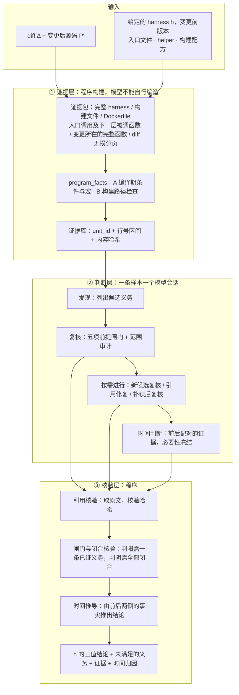

# 面向库变更的 fuzz harness 维护需求静态检测（研究构想，2026-11-12）

> 问题单位是**（提交 × 单个 harness）配对**，harness 由使用者给定。
> 给定变更和指定的 harness，判断是否需要维护以及问题出现的时间。
> 项目级的 harness 定位、测试范围表与项目级汇总不在本文范围内，列于 §5.2。
> 文中的数字都来自开发集的 48 条样本，只说明可行性，不能作为论文的最终结果。
> **待核对**：开发集版本号在文中出现过 Dataset-v8（§4.2.1）与 Dataset-v9（§5.1）两种写法，定稿前请统一。

**一句话概括**：一次库提交合入之前，不编译、不运行 fuzzer，就判断出一个给定的 fuzz harness 是否因为这次变更需要更新；对结论给出程序核验过的证据，并说明问题是这次变更引入的，还是原本就存在。

---

## 1. 研究背景

### 1.1 持续 fuzzing 依赖 harness，但 harness 不会随库自动演化

- 以 OSS-Fuzz 为代表的持续 fuzzing 已经成为 C/C++ 开源项目的基础设施。fuzzer 能测到什么，取决于 **harness**，也就是把 fuzzer 输入转换成库 API 调用的胶水代码。
- harness 和被测库在同一个仓库里一起演化，但通常只有构建失败时才会有人去改它。Görz 等人对 OSS-Fuzz 上 harness 退化的实证研究（FSE 2026）发现，平均而言覆盖率相当稳定，但个体差异很大；造成退化的主要原因是构建失败。他们和 OSS-Fuzz、Fuzz Introspector 团队合作增加了退化指标，这说明业界已经意识到了这个问题。
- Zhu 和 Böhme 在 OSS-Fuzz 上观察到（CCS 2021）：一个项目的漏洞报告越多，新报告是回归缺陷的概率越高，到几百份报告之后可达 92%。**新提交的代码是缺陷的主要来源，而它们能不能被 fuzz 到，取决于 harness 有没有跟上。**
- Gao 等人对 fuzz blocker 的研究（Fuzzing 2023 注册报告）初步发现：阻碍覆盖率增长的主要 blocker 大多与程序输入无关，需要靠修改或生成 fuzz driver 来解决，而不是靠变异输入。

### 1.2 两类“过时”：显式的容易发现，隐式的没人报警

| 类型 | 表现 | 现有机制能否发现 |
|---|---|---|
| **显式** | harness 编译失败，或者回放语料时出现与 API 契约相关的崩溃 | 能，构建失败和崩溃都会报警，但只在合入之后才发现 |
| **隐式** | harness 能编译、能运行、不报错，但这次变更引入或修改的核心行为永远执行不到 | 基本发现不了：没有报警，覆盖率的平均值也看不出来 |

真实例子来自开发集中的 zstd（V3-15）：一次合并为解码器新增了无魔数帧格式，这种格式只能通过 `ZSTD_DCtx_setFormat()` 选择。解码 harness 创建了解码上下文，却从不设置格式，所以新格式的解码分支**任何输入都执行不到**。harness 照常编译、照常运行，不会有任何报警。这条解码路径直到几年后才被一个新 fuzzer 覆盖，随即就发现了无魔数解码中的真实缺陷。

### 1.3 为什么现有手段难以及时发现源码与 harness 的失配

| 难点 | 具体表现 | 对应的问题 |
|---|---|---|
| **覆盖反馈总是滞后，局部失配难以显现** | 依赖覆盖结果的告警，要先执行测试、采集数据，才能发现异常，天然滞后于提交。少量新增分支没有被触达，或者原有的局部分支失去可达性，都可能被总体覆盖率掩盖。Görz 等人的研究也发现，OSS-Fuzz 项目的平均覆盖率相当稳定，而个体退化正是被平均值掩盖的。 | 为什么**不容易发现** |
| **动态确认成本高，结果受随机性影响** | 要用动态对照确认退化，通常需要对提交前后两个版本分别编译，并进行多轮 fuzzing。在有限预算下，输入搜索的随机性会干扰覆盖率比较，难以区分“暂时没搜到”和“被 harness 阻断”。本工作的数据集为此对每个版本都跑了 3 个种子，并要求结论在多数种子上成立，代价很高。 | 为什么**不容易确认原因** |
| **缺少目标触达检查，执行成功存在盲区** | 不同于带有明确行为预期的单元测试，许多 harness 主要检测崩溃和运行异常。目标路径无法触达时，不一定会触发任何已有断言，所以无法通过测试失败发现维护需求。 | 为什么**现有检查保持通过** |

因此，需要一种**无需编译与执行**、直接**分析源码与 harness 之间失配**的检测方法：识别维护需求，并给出位置与原因作为依据。

### 1.4 实际场景：PR 合入前，针对单个 harness 的检查

这项检查现在没有人在跑。库侧 PR 的作者不会去想 fuzz harness；`fuzz/` 目录通常也没有 CODEOWNERS，没有谁被指派去想这件事。Görz 等人观察到的“只有构建失败才有人去改 harness”，正是这种缺位的结果。

所以本文把场景定在**一次提交对一个给定 harness 的影响**上：使用者手上有一个 harness（自己写的、自己在跑的），库侧来了一个 PR，他想知道“**这个 PR 合进去之后，我这个 harness 会不会失配？**”这个问题有三个约束：

- **时机**：要在合入之前回答。等 fuzzing 跑完、覆盖率数据出来再回答就晚了；
- **成本**：每个 PR 都把 harness 编译一遍、跑一轮 fuzzing，代价太高，而且结论还会被输入搜索的随机性干扰；
- **归因**：就算已经知道是哪个 harness，也仍然不知道它到底哪里失配、这条失配是不是这次 PR 引入的。**这是覆盖率跑完了也答不上来的那一个约束**，也是本文要回答的核心问题。

**谁会这样用**：下面四类使用者中，前三类的调用单位天然就是（PR × 单个 harness）。

| 使用者 | 典型形态 | 调用单位 |
|---|---|---|
| 库内 harness 的作者 / PR 的 reviewer | fuzzer 放在 `fuzz/`、`tests/fuzz/`，与库同一批人写，但极少在同一个 PR 里同时改 | 项目级是“一对少”，但在 §3.1 的 A2 下可分解为 N 次独立的一对一调用 |
| **外部贡献的 harness 的作者** | 安全研究者、oss-fuzz-gen 产物、第三方安全团队贡献的 fuzzer | 真正的一对一。所有权割裂本身就解释了“harness 为什么不被维护” |
| **下游 / 消费方的 harness 作者** | 发行版维护者、企业 fuzz vendored 依赖、大型项目 fuzz 自己的第三方依赖 | 真正的一对一；而且“变更后的 harness 不可用”（§3.1 A1）在这里是自然事实，不是人为设定 |
| fuzzing 服务 / PR 机器人 | OSS-Fuzz 自身、在 PR 上留评论的 bot | 项目级，需要先定位 harness → 见 §5.2 |

需要强调的是，“一对一”是**这项检查本身的性质**——在 A2 下 N 个 harness 的判定互不耦合，可以逐个独立进行——而不是对开源项目组织结构的经验断言。本文不主张存在专职的 harness 维护者；真正的缺位不是“没有专人”，而是**没有任何人被指派去想这件事**。

---

## 2. 研究现状

### 2.1 相关研究方向

**(1) fuzz driver / harness 生成**

- FuzzGen（USENIX Security 2020）从库的使用者代码中学习 API 用法，合成 driver。
- Hopper（CCS 2023）做库的解释式 fuzzing。
- PromptFuzz（CCS 2024）用 LLM 生成 driver，并用覆盖率引导提示词的变异。
- Zhang 等人（ISSTA 2024）系统评估了 LLM 生成 driver 的效果。
- Google 的 OSS-Fuzz-gen 已在工业界使用。

这些工作都在回答“**从零开始写一个新 harness**”，没有回答“**库变了以后，已有的 harness 要不要改**”。

**(2) harness 退化与 fuzz blocker 分析**
- Görz 等人（FSE 2026）做了 harness 退化的实证研究；
- Ding 和 Le Goues（MSR 2021）研究了 OSS-Fuzz 上的缺陷；
- Gao 等人（Fuzzing 2023）研究了 fuzz blocker；
- Fuzz Introspector 结合静态调用图和运行时覆盖率来定位 blocker；
- **FuzzMedic**（Zhao 等人，arXiv 2611.06358，2026-11）用 agent 修复 OSS-Fuzz 上已经发生的构建失败；
- **RAISE**（Kato 等人，“Raise or Check?”，arXiv 2610.27828，2026-10）按“项目 × 天”预测是否引入了漏洞、是否需要追加 fuzzing，使用的特征包括提交的静态特征和 OSS-Fuzz 的覆盖率（PatchCoverage 最重要）；
- **QuartetFuzz**（Sheng 等人，arXiv 2605.21824）给出 harness 正确性的四条原则（逻辑正确、API 协议合规、安全边界、入口充分），并以此审计了 586 个现有 harness。

这些工作要么是**事后的、动态的**（先运行，有了覆盖率或构建日志才能分析），要么只针对**已经发生的构建失败**，要么检查的是 **harness 本身是否写对**，不关心库的演化。最接近的 RAISE 做的是预测，但它的预测单位是“项目 × 天”，回答的是“要不要多跑 fuzzing”，不是“哪个 harness 要改”。

**(3) 变更感知的 fuzzing**
- AFLGo（CCS 2017）做定向灰盒 fuzzing；
- AFLChurn（CCS 2021）在调度时偏向最近修改过的代码。

它们都**默认 harness 已经能到达变更的代码**，只是把 fuzzing 的精力往那里倾斜。harness 根本到不了的代码，调度得再好也没用。

**(4) 生产代码与测试代码的协同演化**

- SITAR（SANER 2021）最早研究生产代码与测试代码的协同演化，并预测测试是否需要随之修改；
- CEPROT 给定一次生产代码变更和对应的测试，判断测试是否过时并自动更新；
- ReAccept（ISSTA 2025）用 LLM、检索增强和动态验证来完成过时测试的识别与更新；
- UTFix 修复因方法变更而失效的单元测试；
- **TEBench**（Shang 等人，arXiv 2605.06125，2026-05）是与本工作在概念上最接近的工作：给定一次提交，在整个项目里找出 Breaking（失败）、Stale（仍然通过，但已经不能有效验证新行为）、Missing（需要新增）三类测试。其中 **Stale 最难，平均 F1 只有约 36%**，原因是没有执行失败这个信号。论文还发现，各种 agent 普遍**召回率高于精确率**（差 9.1 到 17.8 个百分点），说明它们普遍倾向于多报。

这些工作的对象是 Java 单元测试，以断言为中心，依靠动态验证。TEBench 的 Stale 类，就相当于本文的“隐式过时”在单元测试上的对应。它在单元测试上都只有约 36% 的 F1，说明这类问题本身就很难。两项工作都观察到 LLM 倾向于多报：TEBench 给出了量化数据；ReAccept 只在方法动机中提到预备实验的观察，没有给出数据，原话是 LLM 认为“任何生产代码变更都会让相关测试过时”。这正是本工作在误报控制上要专门处理的问题。

**(5) 回归测试选择与变更影响分析（与本文正交）**

- Ekstazi（ISSTA 2015）为每个测试记录它在运行时依赖的文件，文件没变就跳过该测试；
- 近期有工作用 GPT-5 做代码变更影响分析，结果表明 LLM 直接预测受影响实体的效果还比较差；
- **CIFuzz**（OSS-Fuzz 的 CI 组件）在 PR 上只运行“受影响的 fuzzer”。做法是把 diff 改动的文件，与每个 fuzzer 在最近一次 OSS-Fuzz **动态覆盖率报告**里覆盖到的文件取交集；没有覆盖率数据时，就运行全部 fuzzer；
- Klooster 等人（SBFT 2023）研究了 CI/CD 中的持续 fuzzing，提出对无关提交跳过 fuzzing，在部分库上可以节省约 63% 的工作量。

这类工作回答的是“**哪些测试或 fuzzer 受影响、需要重跑**”，是**选择问题**；本文回答的是“**给定这一个 harness，它是否需要被修改**”，是**判定问题**。两者正交：本文假设 harness 已由使用者给定（§3.1 A1），因此不与这条线上的方法竞争，也不把它们当作定位基线。

有两点仍然要记下来，它们是 §5.2 把定位列为后续工作时的依据：其一，对 fuzz harness 来说“受影响”是常态，而“受影响”不等于“需要修改”——这正是本文用义务加闸门去区分的东西；其二，CIFuzz 依赖已有的动态覆盖率、按文件粒度筛选，**一段还没有被任何 harness 覆盖过的新代码恰恰就是隐式过时的情形，它无法据此判断**。

**(6) LLM 辅助的静态分析**

LLift 把静态分析工具和 LLM 结合，判断静态分析给不出结论的报告，并用自我验证减少幻觉。本工作沿用“程序负责精确的部分，LLM 负责语义判断”的分工，并进一步让**程序核验 LLM 引用的每一条证据**。

**(7) 测试义务（test obligation）**

“义务”是覆盖准则研究中的已有概念。Whalen 等人（ISSTA 2006）用它描述需求覆盖准则要求测试满足的条件；OMC/DC（ICSE 2013）在 MC/DC 的义务上加了“效果必须传播到可观察输出”的要求，与本文义务中的“能力 / 后果”两项思路相近。本文借用这一概念，**不声称义务这个概念是新的**。

### 2.2 别人研究什么、我研究什么、区别在哪里

| 维度 | 已有工作 | 本工作 |
|---|---|---|
| 问题 | 生成新 harness / 事后分析覆盖率退化 / 更新单元测试 / 选择受影响的测试 | **提交级、逐 harness 的维护需求预测**：这个 harness 要不要改、为什么要改、问题是不是这次引入的 |
| 问题单位 | 项目 × 天（RAISE）／在整个项目里搜索测试（TEBench）／（变更，测试）配对（CEPROT、ReAccept、SITAR） | **（变更，harness）配对**，与 CEPROT 一类协同演化工作同一形式；harness 由使用者给定，不做项目级搜索 |
| 时机 | 运行之后（覆盖率、崩溃、构建日志） | 纯静态，不编译、不运行 |
| 对象 | 单元测试（Java、以断言为中心）或整个项目的覆盖率 | 以 fuzz harness 为中心的 C/C++“操作面”，包括调用、参数、状态复用和构建配方 |
| 输出 | 生成的代码 / 覆盖率指标 / 受影响测试列表 | 对给定 harness 的一个三值结论（需要维护 / 范围内已满足 / 证据不足），附带义务和经程序核验的证据，加上时间归因 |
| 隐式过时 | 只能事后从覆盖率发现 | **静态推断**：“这次变更的核心行为，harness 本来应该能到达，但现在永远到达不了” |
| “受影响”与“需要改”的区分 | 回归测试选择把两者等同 | 用**义务**加**五项前提闸门**区分：受影响但仍满足义务的，判为不需要维护 |
| 责任范围 | 不界定 | 判定只针对本 harness，**不允许用另一个 harness 抵消本 harness 的失效**；由此 N 个 harness 的判定互不耦合，可逐个独立进行 |
| 可信度 | LLM 直接输出结论 | **规格驱动的提示词，引用由程序取原文、校验哈希，闸门和闭合由程序判定**；“证据不足”是一等输出 |

---

## 3. 研究方法

### 3.1 问题定义

**输入**：

- 变更前的程序 P、变更后的程序 P′、diff Δ；
- 一个 harness h，**由使用者给定**，包括入口文件、helper 和构建配方。h 是**变更前**的版本；变更后的 harness 不可用。

**输出**：

1. **维护判断**：对 h 给出 `needs_update`、`satisfied_in_scope` 或 `unknown`。判为需要维护时，附上未满足的义务，以及经过程序核验的证据。
2. **时间归因**：对判为需要维护的 h，给出 `introduced`（本次引入）或 `preexisting`（原本就存在）。

**范围假设**：下面五条是本文明确承认的边界，不是遗漏。

| 编号 | 假设 | 依据 |
|---|---|---|
| **A1** | 输入是（Δ, h）配对，h 为变更前版本，变更后的 harness 不可见 | 对应 §1.4 的三类使用者；与 CEPROT、ReAccept、SITAR 的问题形式一致 |
| **A2** | **单 harness 责任**：结论只针对 h，不允许用项目里其他 harness 的能力抵消 h 的失效 | 见 §3.3(5)。这条同时保证 N 个 harness 的判定互不耦合，项目级的“一对多”可分解为 N 次独立调用 |
| **A3** | 单次提交 / PR，且只取其中的**库侧代码**；harness 侧的改动不作为输入 | 数据集中唯一一条“库与 harness 同改”的样本也按此处理（§4.2.1） |
| **A4** | 不编译、不运行、不依赖任何覆盖率数据 | §1.4 的时机与成本约束 |
| **A5** | “这个功能是否还有**任何** harness 在测”这类项目级缺口问题**不在范围内** | 需要项目级定位与汇总，记入 §5.2 |

**与项目级使用的关系**：在 A2 下，对一个 PR 把项目里全部 N 个 harness 逐个跑一遍是合法的，因为每次判定互不依赖。这条路径在 §4.3 的 RQ5 中作为主要部署配置评估成本；它不需要定位，**定位只是对它的成本优化**（§5.2）。

### 3.2 系统总览

整个方案分三层，各层的分工是：
- **程序决定“看什么”**：证据包与 program_facts；
- **模型决定“意味着什么”**：语义判断；
- **程序决定“算不算数”**：核验与三值汇总。

**项目级使用时的组合方式**：若使用者要对一个 PR 检查全部 N 个 harness，就是把上图独立运行 N 次，N 次之间不交换任何中间状态——这一点由 A2 保证（§3.3(5)）。

### 3.3 核心抽象

**(1) 义务**

“harness 需要维护”被定义为：存在一条**未被满足、且有证据支持的义务**。义务是一个四元组：

  ⟨操作，条件，能力，后果⟩

义务分两类：
- **执行兼容（D4）**：harness 能构建、能初始化、能调用它的操作，对象的生命周期和状态合法，已有的断言仍然成立。
- **目标覆盖（D5）**：这次变更的**核心行为**是 harness 应该能到达的。

**(2) “应该触达”的两步判定（D5）**

- **第一步**：只要存在某个合法输入能执行到这次变更的核心行为，就不产生覆盖义务。变更中其他没执行到的部分不算（D7f）。
- **第二步**：如果执行不到，就看 harness **用自己已有的操作、换一种用法**能不能到达。“换一种用法”包括：多调用一次或复用同一个对象、同一个调用的其他选项、仓库自带的构建开关、同一入口的其他输入形式、修掉 harness 自身阻挡它的缺陷。能到达的，就是未满足的义务。只能通过 harness 本来不用的入口才能到达的，不算义务（D7c）。

**(3) 五项前提闸门与非对称三值判定（J1–J5）**

- 判为 `needs_update`，要求至少一条义务的五项前提都有源码和 harness 两侧的证据：属于测试范围、存在可行的触发方式、有可观察的后果、排除了等价路径、被评估的始终是同一条义务。
- 判为 `satisfied_in_scope`，要求所有候选义务都闭合。
- 两者都做不到时输出 `unknown`，不会被强行归为阴性。

这个设计专门用来抑制“看到变更就认为需要改”的偏差，ReAccept 在动机部分也提到过这种偏差。

**(4) 按义务类别做时间归因（T2）**

- **执行兼容类**：比较变更前后的失败情况。
- **目标覆盖类**：找出 harness 下**最内层、从未被满足的条件**。
  - 这个条件是本次新增的 → 本次引入；
  - 它早就存在，而且以前同样从未被满足 → 原本就存在；
  - 它早就存在、以前能被满足、这次变更让它无法满足 → 本次引入。

**(5) 单 harness 责任范围（D8 的范围约定）**

等价路径（D8）只限于**同一个 harness 自己**的输入形式和调用顺序。“项目里另一个 harness B 也能到达这段代码”，不能抵消“h 到不了”这一事实。

- **为什么这样定**：harness 的价值在于它自己能持续触达它负责的那部分行为。若允许跨 harness 抵消，问题就退化成“这段代码在项目层面有没有被覆盖”——那是覆盖率已经能回答的问题，而且会把本来需要修的 harness 判成不需要修。
- **与回归测试选择的分界**：回归测试选择只关心“整体还有没有测试覆盖到”，因此天然允许抵消；本文关心的是“**这一个** harness 是否还在履行它的职责”。
- **它带来的一个性质**：N 个 harness 的判定因此互不耦合，项目级的“一对多”可以分解为 N 次独立的一对一调用（§3.1）。**这是本文可以不做定位、只做逐 harness 判定的前提。**
- **它不回答什么**：“这个功能在项目层面是否还有有效测试”需要把 N 个结论汇总起来，属于 A5 排除的范围，记入 §5.2。

### 3.4 方法论：为什么这么设计

| 层次 | 原则 | 要防止的问题 |
|---|---|---|
| 问题抽象 | 用义务定义“需要维护”；用两步法定义“应该触达”；时间归因按义务类别区分 | 把“受影响”当成“需要改”；把“没有执行到所有改动行”当成“需要改” |
| 适用边界 | 问题单位收缩为（变更，harness）配对，范围假设 A1–A5 显式列出；单 harness 责任（D8）使 N 个判定可分解 | 动机场景与实际评测的任务不一致；用跨 harness 的覆盖抵消掉本该修的 harness |
| 判断方法 | 规格是提示词的唯一来源；模型只给判断和引用位置，程序核验证据并汇总；判阳的门槛低于判阴，证据不足输出 `unknown` | 提示词里出现针对个别样本的规则；模型幻觉；在证据不足时强行判阴 |
| 工程落地 | 模型找不到的证据由程序补齐（构建配置、路径、前后配对）；一条样本一个会话，只发增量 | 漏掉构建配置导致误判；成本过高 |
| 评测方法 | 静态定义与动态标注口径对齐；保留 B / C 两类硬阴性；重复运行，技术失败单独统计；另报部署基准率下的精确率；开发集纪律与修订日志 | 定义和标签不一致；配对本身泄露“这个 harness 与本次变更有关”；把 1:1 数据集上的精确率当成部署精确率；把随机波动当成方法改进的效果 |

### 3.5 新的点（论文贡献）与新颖性核查

2026-11-11 检索了 2023–2026 年的会议论文和 arXiv 预印本，下面每一项都写明了“已有工作做到哪一步”“本文新在哪里”，以及建议的稳妥表述。

| 编号 | 贡献 | 已有工作做到哪一步 | 本文新在哪里 | 新颖性判断 |
|---|---|---|---|---|
| C1 | **问题形式化**：给定（提交，harness），纯静态地预测维护需求，包括隐式过时和时间归因 | Görz 等人事后测量 harness 退化，摘要里称退化“难以预测”，并把自动维护列为未来工作；Fuzz Introspector 在运行时发出覆盖率下降告警；FuzzMedic 修复已经发生的构建失败；RAISE 按“项目 × 天”预测是否需要追加 fuzzing；**CEPROT 的问题形式与本文相同——给定一次生产代码变更和对应的测试，判断测试是否过时——但对象是 Java 单元测试**；TEBench 在整个项目里搜索三类测试；SITAR、ReAccept 同属单元测试的协同演化 | 在 fuzz harness 上，没有找到“给定（提交，harness），静态预测是否需要维护，包括隐式过时，并区分本次引入还是原本就存在”的工作。相对 CEPROT 一类工作有三点差别：fuzz harness **没有断言作为失败信号**；需要处理**隐式过时**（能编译、能运行、不报错）；多出**时间归因** | **新，可以作为主要贡献**。但不能说“首次研究 harness 退化”，也不能说“首次检测 harness 退化”；同时**不能暗示本文在项目范围内搜索 harness** |
| C2 | **义务表示与判定框架**：义务四元组、两类义务、两步法“应该触达”、单 harness 责任范围、五项前提闸门、非对称三值输出；规格驱动的提示词，引用由程序核验 | “测试义务”是覆盖准则研究中的已有概念（Whalen 等人，ISSTA 2006；OMC/DC，ICSE 2013）；QuartetFuzz 给出了 harness 正确性的四条原则，但与演化无关；单元测试过时识别都是分类器或 LLM 直接判断，没有义务形式化 | 把义务具体化为面向“harness 与库协同演化”的四元组、两类划分与五项前提闸门，并加上单 harness 责任（D8）这条范围约定；没有找到等价的形式化 | **具体的形式化是新的，但概念是借用的**。必须引用 Whalen 等人的工作，表述为“借用测试义务的概念” |
| C3 | **高效的级联会话**：一条样本一个会话、增量发送、缓存稳定、时间判断按需进行 | AutoCodeRover 等工作都把成本作为卖点（例如 lite 上平均每个任务 0.43 美元） | 工程优化，与 v7 相比单条从约 1686 秒降到约 371 秒；并由此支撑“对一个 PR 把全部 N 个 harness 逐个跑一遍”在成本上可行（RQ5） | **属于工程贡献**，放在实现与效率评估里讲，不单列为创新点 |
| C4 | **数据集与实证发现**：显式/隐式、本次/原有、类型标注，含 B/C 两类硬阴性；静态定义与动态标签的对齐分析 | TEBench 有单元测试的演化数据集；QuartetFuzz 公开了 100 个标注过正确性的 harness；Görz 等人有退化的度量数据。没有找到面向“提交 × harness 维护需求”的公开数据集 | 第一个带维护标签和时间标签的提交级 harness 数据集；其中 B 类硬阴性（改动行覆盖为 0，但只能靠 harness 本来不用的新入口才能到达）专门用来检验“受影响 ≠ 需要改” | **新，可以作为贡献** |

**建议的稳妥表述**（论文引言中使用）：

> 据我们所知，本文首次把 fuzz harness 维护形式化为一个**静态的、提交级的、逐 harness 的预测任务**：给定一次库侧变更和一个 harness，判断该 harness 是否需要更新；它覆盖隐式过时，并区分问题是本次变更引入的还是原本就存在。已有工作或者在事后测量退化 [Görz et al.]，或者在运行时监控覆盖率 [Fuzz Introspector]，或者在构建失败发生后再修复 [FuzzMedic]，或者在项目层面预测是否需要追加 fuzzing [RAISE]；单元测试上的对应问题已有研究 [SITAR, CEPROT, TEBench]，其中 CEPROT 与本文的问题形式一致，但对象是以断言为中心的 Java 单元测试。我们借用覆盖准则研究中“测试义务”的概念 [Whalen et al.]，把维护需求定义为一条未被满足的义务。

**对贡献排序的建议**：
- 主要贡献：C1（问题）、C2（义务表示与可核验的判定框架）、C4（数据集）；
- 效率：C3 放在评估里讲，并与“全量 N 个 harness”的部署成本一起报告。

**需要特别处理的三项工作**：

- **CEPROT**：问题形式与本文相同（给定变更与对应测试，判断是否过时），是本文形式化上的直接先例，必须在引言中点明，并说清三点差别（无断言信号、隐式过时、时间归因）。
- **TEBench**：概念上最接近，但它**在整个项目里搜索**测试，范围比本文大；本文明确不做项目级搜索（A5）。可以引用它的 Stale 类 F1 只有约 36% 来说明：即便在有断言、有执行信号的 Java 单元测试上，这类“仍然通过但已失效”的判定本身就很难。
- **RAISE**：预测框架上最接近。需要说明两者的预测单位和要回答的问题都不同。

**不作为基线比较的工作**：CIFuzz 的受影响 fuzzer 选择、Ekstazi 式的文件依赖、Fuzz Introspector 的静态可达集，属于“选择”而非“判定”（§2.1(5)）。其中 Fuzz Introspector 的可达性仍作为**判定基线** B1 保留（§4.3），因为“改动函数不在 h 的可达集中”本身就是一条可以逐 harness 评估的朴素判定规则。

TEBench、RAISE、FuzzMedic、QuartetFuzz 四篇都是 2026 年的预印本，投稿前要再检查一次是否已经正式发表、版本是否有变化。

### 3.6 论文贡献总结

**1. 提出基于维护义务的 Harness 维护需求判定方法，将程序变更与 Harness 能力之间的失配转化为逐项可复核的判定对象。**

区分执行兼容与目标覆盖两类义务，通过“当前合法输入是否可达—调整已有操作的用法后是否可达”的两步判定，界定旧 Harness 对变更行为的维护责任。为候选义务分配稳定标识，并记录对应变更、触达路径、阻断条件和替代路径，使后续分析持续围绕同一项维护需求展开。

这里值得突出的思想是：**先明确 Harness 应承担什么责任，再判断它是否缺失相应能力。** 义务四元组是概念模型；实现支撑是候选义务结构、类别与依据枚举，以及覆盖见证，不能宣称已经建立了程序化的操作面提取。

**2. 构建具有非对称证据要求的维护判定机制，通过逐义务核验与整体范围审计约束结论生成。**

对维护结论，要求至少一条候选义务具备完整的五项前提、有效的源码与 Harness 双侧证据及具体触发见证；对范围内已满足结论，要求候选义务全部解决、逐变更组审计与构建、输入、生命周期、控制流基础检查均闭合。程序核验引用真实性、字段完整性和分类一致性，将不满足要求的判断降为不确定，并据此汇总三值结论。

这里的亮点是：**一条成立的义务即可支持维护，缺少成立的义务却不足以支持无需维护。** 你的实现还通过整体范围审计约束阴性，已经比“把所有发现的候选处理完”更进一步。但这仍是对证据与结论条件的核验，不等同于验证模型的语义推理正确。

**3. 设计由未闭合义务驱动的有界级联复核机制，使证据补充、局部重审与停止决策围绕未解决问题展开。**

根据模型声明的信息缺口增量补充证据，对未确定义务和新发现义务分别复核；引用错误通过局部修复处理，修复过程保持原判断内容不变。结合非对称判定门槛设置提前停止条件，将达到轮数上限仍未解决、或尚未复核的候选保留为不确定，避免分析预算耗尽被解释为无需维护。维护必要性确定后，再冻结该判断并进行时间归因。

这里应准确写成**“缺口驱动的补读与复核”**。目前补读什么仍由模型请求，尚不能写成“系统根据未闭合前提自动推导检索动作”。

如果压缩为论文引言中的三条贡献，可以使用：

1. **提出基于维护义务的 harness 维护需求判定方法：以变更核心行为能否被执行为起点，区分执行兼容与目标覆盖，并以已有操作的可调整空间界定维护责任，将变更影响转化为具有稳定身份的候选义务。**
2. **构建结合基于程序核验证据的逐义务核验与整体范围审计的非对称三值判定机制，以不同的证据闭合要求约束维护与已满足结论，并将证据不足显式保留为不确定。**
3. **设计由未闭合义务及其声明的证据缺口驱动的有界级联复核机制，通过增量补读、局部复核、受限引用修复及明确的停止规则，在有限分析预算内推进维护判定。**

---

## 4. 实验设计

### 4.1 参考的两篇 ISSTA 方法类论文（已对照全文核实）

两篇都已对照全文读过：ReAccept 读的是 arXiv v1（2411.11033，只有这一个版本，可能与 ISSTA 正式版有出入）；AutoCodeRover 读的是 arXiv v3，这一版带有 ISSTA'24 的 DOI，基本就是正式版。

**(1) ReAccept（ISSTA 2025）：生产代码与测试代码的协同演化**

问题最接近本文：给定一次生产代码的变更，先判断对应的测试是否过时，再把它更新。

| 维度 | 他们的做法 |
|---|---|
| RQ 结构 | RQ1 整体效果（识别 + 更新端到端）→ RQ2 识别阶段 → RQ3 更新阶段 → RQ4 影响因素（消融） |
| 数据 | 在 SITAR、CEPROT、CHOSEN 三个已有数据集基础上扩展，共 537 个 Java 项目、23,403 个样本，按 9:1 划分训练集和测试集。标签来自提交历史：同一次提交里测试被改了，就算阳性。动态评测另外选了 6 个项目、103 个样本 |
| 基线 | 通用方法：随机猜测、KNN、NMT；领域方法：SITAR、CHOSEN、CEPROT。只能做识别的基线，只在 RQ2 中比较 |
| 指标 | 识别：准确率，以及**阳性类和阴性类分别**的精确率、召回率、F1。更新：CodeBLEU、编译通过率、测试通过率、覆盖变更率 |
| 消融 | 换 LLM（4 个 GPT 型号）、温度、Top-P、去掉检索增强、去掉动态验证、迭代上限 |
| 随机性与统计 | 温度设为 0，每个结果只跑一次；没有报告成本、时间、token，也没有显著性检验 |
| 其他 | 讨论一节中有一个 case study；有效性威胁分为内部、数据、外部三类 |

**本文借鉴的做法**：
- 按“主结果 → 分维度 → 影响因素”组织 RQ（本文的问题只有判定一个阶段，所以不照搬 ReAccept 的“识别阶段 / 更新阶段”两段式，见 §4.3）；
- 基线既包括简单方法（随机猜测、启发式规则），也包括领域方法；
- 阴性类单独报告精确率、召回率和 F1；
- 标签来自维护者的真实修复，并在有效性威胁中讨论数据有效性。

**更正**：之前写的“ReAccept 报告了 LLM 的系统性偏差”需要修正。这一观察出现在**方法章节**（3.3.1），来自一个没有给出数据的预备实验，原话是 LLM 会“presuming that any modification to the production code would render the correlated test cases obsolete”。论文里可以引用它作为动机，但不能说它是实验结论。

**(2) AutoCodeRover（ISSTA 2024）：LLM + 程序结构化检索，自动解决 GitHub issue**

技术路线最接近本文：程序侧负责结构化检索，LLM 负责理解问题和生成补丁。

| 维度 | 他们的做法 |
|---|---|
| RQ 结构 | RQ1 整体效果 → RQ2 已有分析技术（SBFL）能否帮助 → RQ3 还有哪些挑战（失败分类） |
| 数据 | SWE-bench（2294 个 issue）、SWE-bench lite（300 个）、Devin 子集（570 个） |
| 基线 | SWE-agent 和 Devin，**直接引用它们报告的结果，没有重新运行** |
| 指标 | 解决率，**每个任务的平均时间和 token 成本**。例如在 lite 上：解决率 19%，平均 195 秒，3.7 万 token（约 0.43 美元）；SWE-agent 是 24.5 万 token（约 2.51 美元） |
| 随机性 | “为避免 LLM 的随机性，实验重复三次”，报告 @1 和 @3；没有方差和显著性检验 |
| 消融 | **没有系统的组件消融**，只有一个加入 SBFL 的变体（RQ2） |
| 补丁正确性 | 对所有通过测试的补丁，**至少两位作者交叉人工核对**是否与开发者补丁语义等价，结果是 65.4% 真正正确 |
| 其他 | 有动机案例和 RQ2 的 case study；RQ3 对失败做了分类（补丁错、位置错、文件错、没有生成补丁）；有效性威胁只列了两条（LLM 随机性、补丁过拟合） |

**本文借鉴的做法**：
- 效果和成本放在同一张表里报告（时间、token、调用次数）；
- 重复运行 3 次；
- 与基线做重叠分析（谁独有地判对了哪些样本）；
- 对判对的阳性，人工核对理由是否正确，对应他们区分“通过测试”和“真正正确”；
- 用一个 RQ 专门做失败分类。

**本文要比两篇参考做得更多的地方**：
- 两篇都没有做显著性检验，也没有报告方差；本文样本少，需要补上这两项；
- AutoCodeRover 没有做组件消融，而本文的贡献在于规格、核验和程序事实这些组件，必须用消融来证明；
- 本文没有现成的工具可以引用结果，所有基线都要自己运行。

**补充参考**：Zhang 等人（ISSTA 2024）系统评估了 LLM 生成 fuzz driver：5 个 LLM、6 种提示策略、多个温度，并报告了 token 成本。本文“多模型”设置可以引用它作为依据。

### 4.2 数据集

数据集的基本单位与问题定义一致：**一条样本 = 一个（提交，harness）配对**（§3.1 A1）。开发集现有的 48 条就是 48 个这样的配对。

#### 4.2.1 开发集：48 条

**构成**：在“显式 / 隐式”和“阳性 / 阴性”两个维度上各按 1:1 划分，得到四个象限，每个象限 12 条。

| 象限 | 条数 | 按类型分布（6 类：api / configuration / input_format / state / lifecycle / mix） | 时间标签 |
|---|---:|---|---|
| 阳 · 显式 | 12 | 每类 2 条，其中本次引入、非本次引入各 1 条 | 本次 6 · 非本次 6 |
| 阳 · 隐式 | 12 | 每类 2 条，其中本次引入、非本次引入各 1 条 | 本次 6 · 非本次 6 |
| 阴 · 显式 | 12 | 每类 2 条 | 不做时间判定 |
| 阴 · 隐式 | 12 | 每类 2 条 | 不做时间判定 |

- **项目**：33 个 C/C++ 开源项目，单个项目最多 3 条（zlib、libyaml），避免被少数项目主导。
- **变更来源**：全部来自真实提交。其中 1 条阳性来自“库代码和 harness 一起改的提交”，按 A3 只保留其中的库代码部分。
- **标签来源**：

  | 标签 | 来源 | 条数 |
  |---|---|---:|
  | 阳性 | 维护者后来真实修复了这个 harness | 17 |
  | 阳性 | 构建者写反事实修复，并用覆盖率实验验证 | 6 |
  | 阳性 | 从同时修改库和 harness 的提交中拆分得到 | 1 |
  | 阴性 | 动态实验确认：变更前后都能构建，回放语料没有新崩溃，改动的行被执行到 | 24 |

- **标注口径**（`conventions`）：

  | 类别 | 判定条件 |
  |---|---|
  | 显式阳性 | 编译或链接失败，或者回放语料时出现以 harness 为栈顶、或与 API 契约相关的崩溃 |
  | 隐式阳性 | 不修复时，缺口行在 3 个种子下覆盖都是 0；修复后，至少 2 个种子覆盖不为 0 |
  | 阴性 | 改动的行被执行到（覆盖大于 0）、没有新崩溃；隐式阴性还要求至少 2 个种子成立 |
  | 本次 / 非本次 | 修复应用到变更前的版本上，如果能消除同一缺口，或者 harness 在变更前就已失败，则为“非本次”；否则为“本次” |

- **使用约束**：规格的多次修订都是在看过开发集的错误之后做的，所以开发集上的结果**只说明可行性**，不能作为论文的主结果。论文里应如实报告这一点，并附上修订日志（`规则审计.md`）。

#### 4.2.2 主数据集：D-test

| 数据集 | 用途 | 结构 | 现状 |
|---|---|---|---|
| **D-test**：独立测试集 | RQ1–RQ6 的主结果 | 沿用开发集的四象限、6 类型、阳性本次/非本次逐类配对的结构，按同一比例扩大（每格乘以 4，共 192 条）。阴 · 显式可以考虑按自然分布取样，不强制按类型均分 | **待建**。规格冻结之后才能接触；优先选模型知识截止日期之后的提交，避免数据泄漏；项目尽量与开发集不重叠，至少要报告重叠项目和非重叠项目各自的结果 |

**硬阴性是必须保留的部分。** 问题单位是配对之后，最大的攻击面是“配对本身就泄露了这个 harness 与本次变更有关”。因此标注口径沿用现有 `conventions`，并保留两类专门设计的难阴性：

| 类别 | 定义 | 它要检验什么 |
|---|---|---|
| **B 类** `negative_other_entry` | 改动行覆盖率为 0，并且只用 harness 已有的调用写不出能到达它的修复，必须引入 harness 本来不用的新入口 | D5 第二步对 D7c 的边界：看起来像隐式过时，但按定义不构成义务 |
| **C 类** | 改动代码与 h 的操作面无交集（h 链接不到、或走的是完全不同的子系统） | 判定器是否在说“配上了就要改”；对应基线 B0b |

两类都必须在 D-test 里保持足够比例，否则“受影响 ≠ 需要改”这个核心论点就没有测试数据支撑。B 类标注报告 Cohen's κ。

**测试集多大合适、最终是什么形式（调研结论）**：建议测试集取 **约 200 条（推荐 192 条：四个象限各 48 条，每类 8 条，阳性每类本次 / 非本次各 4 条）**，最终以与开发集相同的“逐样本目录 + 冻结清单”的形式发布。依据如下：

- **统计上够用**：

  - 准确率约 80% 时，95% 置信区间的半宽：48 条约 ±11 个百分点，96 条约 ±8 个，192 条约 ±5.7 个。
  - 两种方法的配对比较（McNemar 检验，显著性 0.05、检验效能 0.8）：要检测出 10 个百分点的准确率差异，假设两者判定不一致的样本约占 20%，需要约 155 条；要检测出 8 个百分点的差异（不一致约占 15%），需要约 182 条。
  - 所以 48 条只够说明可行性；192 条才足以支撑“比基线好”“消融有效”这类结论。按阳性 96 条计算的召回率，置信区间半宽约 ±8 个百分点。
- **与同类工作的规模相当**：

  | 工作 | 标签方式 | 评测规模 |
  |---|---|---|
  | ReAccept | 动态验证 | 103 个样本（另有 2,231 条按启发式规则从提交历史挖出的识别样本） |
  | TEBench | 人工标注 | 314 个任务 |
  | FuzzMedic | 可复现的构建失败 | 128 个 |
  | Zhang 等人（ISSTA 2024） | — | 86 个 driver 生成问题 |

  本文的每条标签都要经过编译矩阵、语料回放和 3 个种子的覆盖实验，成本接近 ReAccept 的动态子集和 FuzzMedic，所以 200 条左右是现实可行、也有说服力的规模。
- **最终形式**：

  - 每条样本一个目录，包含：输入（变更后的源码、diff、变更前的 harness 和构建配方）、标签（`case.json`：输入给 oracle；`label.json`：不能泄露给 oracle）、动态证据（编译矩阵、回放结果、各种子的覆盖率、修复补丁或反事实修复补丁）、`NOTES.md`（中英文理由）。
  - 整体附带 `dataset.json`（标注口径与分布）、带哈希的冻结清单、开发集与测试集的划分文件，以及可复现的构建镜像说明。

#### 4.2.3 辅助测量数据（供 RQ5 使用，不含人工标签）

这三项测量用来支撑“不做定位”这一范围决定，成本都很低，不需要新的标注：

| 编号 | 测量 | 做法 | 用途 |
|---|---|---|---|
| **M1** | 真实修复提交动了几个 harness 文件 | 对 17 条“维护者后来真实修复”的样本，取其真实修复提交，统计它改动的 harness 文件数 | **直接用 ground truth 回答一对一 vs 一对多**：若多数修复只动一个 harness 文件，逐 harness 判定就是与真实维护行为一致的单位 |
| **M2** | 每个项目的 harness 数 \|𝓗\| 的分布 | 对开发集的 33 个项目，统计该提交时点的 fuzz target 数（数 `LLVMFuzzerTestOneInput` 入口与 `build.sh` 产出）；并给出 OSS-Fuzz 全库的同一分布作为外部参照（更准的口径是公开覆盖率报告中实际构建成功的 target 清单，优于解析 `build.sh`） | 给出“全量 N 个 harness”部署成本里的 N：中位数、P75、P90 与长尾项目名单 |
| **M3** | 一个 harness 面对的 PR 中真正需要维护的比例（基准率） | 不做全量标注；取若干项目的近期提交区间，按 M1 的方式统计“改动了 harness 的提交 / 全部库侧提交”，作为基准率的粗略上界 | 支撑 RQ5 的基准率敏感性分析；说明 1:1 数据集上的精确率不能直接当部署精确率 |

M2、M3 是外部有效性的材料，不是方法的组成部分；若结果与预期相反（例如 \|𝓗\| 中位数很大），应如实报告，并在 §5.2 中把定位的优先级相应提高。

### 4.3 研究问题

问题单位是**（变更，harness）配对**：给定一次库侧变更 Δ 和一个变更前的 harness h，判断 h 是否需要维护、问题出现在什么时候。围绕这一单位需要回答六个问题。

| 编号 | 问题 |
|---|---|
| RQ1 | 给定一个 harness，能否准确判断它是否需要维护？与基线相比如何？ |
| RQ2 | 对判为需要维护的 harness，能否区分问题是本次变更引入的还是原本就存在？ |
| RQ3 | 方法中的各个组件分别贡献了多少？ |
| RQ4 | 换模型、换推理强度、换调用上限，结论如何变化？重复运行是否稳定？ |
| RQ5 | 对一个 PR 直接跑全部 harness，在成本和报警质量上是否可行？ |
| RQ6 | 剩下的错误集中在哪几类？还有哪些挑战？ |

整体参照 ReAccept 的“主结果 → 分维度 → 影响因素”组织，失败分类参照 AutoCodeRover 的 RQ3。

---

**RQ1 维护判断：给定一个 harness，能否准确判断它是否需要维护？**

- 输入：（Δ, h）配对，h 为变更前版本；不编译、不运行。
- 指标：
  - 准确率；
  - **阳性类和阴性类分别**的精确率、召回率、F1，参照 ReAccept；
  - 误报率、漏报率、`unknown` 的比例。
- 分组报告：显式/隐式，以及变更类型（api / configuration / input_format / state / lifecycle / mix）。**B 类与 C 类硬阴性单独成组报告**——这两组是“受影响 ≠ 需要改”这一核心论点的直接证据（§4.2.2）。
- **理由正确率**：对判对的阳性，两位作者独立核对模型给出的义务是否与维护者的真实修复一致，参照 AutoCodeRover 区分“通过测试”和“真正正确”。

基线全部由我们自己运行：

| 基线 | 说明 | 对应参考 | 是否已有 |
|---|---|---|---|
| B0a 随机猜测 / 多数类 | 下界 | ReAccept 的 RG | 直接计算 |
| B0b 启发式“受影响即需要维护” | 改动函数在 h 的可达集里就报警。用来检验本文的核心论点，**在 B / C 类硬阴性上的表现是这条基线的关键看点** | ReAccept 的启发式基线 | 待实现，成本低 |
| B1 Fuzz Introspector 静态可达性 | “改动函数不在 h 的可达集中 → 需要维护”。注意这里把它当作**逐 harness 的判定规则**，不是定位工具 | 领域工具 | 已在 Task 8 测试集上实测过（`t12-fuzz-introspector-baseline`） |
| B2 直接提示 LLM | 同一个模型，只给 diff 和 harness，一个提示词直接问结论 | ReAccept 的零样本变体 | 待实现 |
| B3 通用 agent | Codex 或 Claude Code 自由读取仓库，不提供规格，也不做程序核验 | AutoCodeRover 对比 SWE-agent | 待实现 |
| B4 v7 方案 | 多模块、大量调用的旧方案 | 本文的前一版 | 已有（44 条共同样本） |

另外做**重叠分析**：本方法与每个基线各自独有地判对了哪些样本，参照 AutoCodeRover 的 Venn 图。

---

**RQ2 时间归因：对判为需要维护的 harness，能否区分问题是本次引入还是原本就存在？**

- 只在判为 `needs_update` 且判对的样本上评估（必要性冻结之后再做时间判断，见 §3.3(4)）。
- 指标：时间判断准确率；维护与时间都正确的**严格准确率**；按义务类别（执行兼容 / 目标覆盖）和按显式/隐式分组。
- 基线：B2、B3 在同一提示下给出的时间判断；以及一条朴素规则——“缺口条件出现在 diff 的新增行里 → 本次引入”。
- 这一 RQ 单独成立的理由：时间归因是 C1 中与已有工作差别最明确的一项（CEPROT、TEBench 都不做），而且它有独立的标签集（开发集中本次 12 条、非本次 12 条），埋在 RQ1 的一列里会被淹没。

---

**RQ3 组件消融：各组件的贡献有多大？**

1. 去掉规格驱动的提示词，改成自由提示；
2. 去掉程序核验，直接采信模型的结论；
3. 去掉 `program_facts`；
4. 去掉时间判断中的前后配对证据；
5. 把级联会话换成旧的双模块流程（`legacy-dual.yaml`）；
6. 去掉 `unknown`，强制二值输出；
7. 把 D5 的两步法换成“所有改动行都要被执行到”；
8. 去掉单 harness 责任约束（D8 允许跨 harness 抵消），观察 B 类硬阴性与阳性召回各自怎么变。

第 8 项检验的是 §3.3(5) 这条范围约定是否真的在起作用：若放开抵消，预期阳性召回下降而对阴性几乎无改善——如果实测不是这样，说明这条约定的论述需要削弱。

---

**RQ4 设置因素与稳定性**

设置因素：
- 模型：Codex 和 Claude，参照 ReAccept 换 LLM 的做法；
- 推理强度；
- 入口调用数上限。

ReAccept 是通过调温度来做的。CLI 后端不开放温度参数，所以本文改为变化模型和推理强度。

稳定性，参照 AutoCodeRover：
- 每个配置重复运行 3 次，报告均值和标准差；
- 报告三值结论的一致率、报警结论的一致率、时间判断的一致率；
- 报告“任一次判对”的上界，对应他们的 @3；
- 技术失败（额度、安全过滤）单独统计，不计入方法错误。

---

**RQ5 部署可行性：不做定位，直接对一个 PR 跑全部 harness，成本与报警质量如何？**

这一 RQ 回答两个在 §3.1 和 §1.4 中被提出的问题。

**(a) 成本：全量 N 个 harness 是否跑得起？** 用 M2 测得的 \|𝓗\| 分布乘以单条成本，给出每个 PR 的时间与 token 投射；与“编译全部 harness + 跑一轮 fuzzing”的参照成本对比。若 \|𝓗\| 中位数较小，则定位是成本优化而非必需（§5.2）；若长尾项目的 N 很大，则按项目分层报告，并明确本文方法在长尾项目上的适用性受限。

**(b) 报警质量：1:1 数据集上的精确率不能直接当部署精确率。** 开发集与 D-test 都是 1:1 正负比例，而一个固定 harness 面对的 PR 流里真正需要维护的比例远低于此（M3）。因此必须报告**基准率敏感性**：固定实测的召回率与误报率，在若干假设基准率下算出部署精确率（表 8c）。这不是一个要藏起来的数字，而是要主动给出的部署刻度。开发集上两个后端的工作点差别在这里会被放大——保守后端（Claude，R 66.7% / FPR 8.3%）在低阳性率下的部署精确率明显高于激进后端（Codex，R 79.2% / FPR 14.6%），而两者在平衡集上的 Acc 只差 3 个百分点。可用的调节手段有两条：

1. **用 `unknown` 做调节阀**：把 `unknown` 路由为“不报警”，以召回换部署精确率，给出对应的工作点曲线。这同时也是三值设计在实用层面的论证。
2. **逐 harness 的相关性过滤**：若需要进一步抑制无关 PR，最小可行的形式是对**单个** h 的二值相关性判断（“这次 PR 与我这个 harness 有没有关系”），而不是项目级的候选选择。这属于 §5.2 的后续工作，本文只给出它能带来多少提升的上界估计（用 C 类硬阴性的比例近似）。

---

**RQ6 失败分析：还有哪些挑战？**

参照 AutoCodeRover 的 RQ3，对所有错误分类：
- 检索遗漏（例如调用数上限）；
- 核心行为认定错误；
- 静态可达性误判；
- 证据缺失（例如跨输入的全局状态）；
- 规格没有覆盖的情况（例如 harness 自身缺陷）；
- 疑似标注问题。

每类给出数量和一个例子。

---

**统计方法**（两篇参考都没有做，本文样本少，所以补上）：

- 配对比较用 McNemar 检验；
- 指标给出 bootstrap 95% 置信区间；
- 标注一致性用 Cohen's κ。

#### 结果呈现模板（初期以表格统计）

约定：
- 所有比例都报告为 **3 次运行的均值 ± 标准差**，主表另附 95% bootstrap 置信区间；
- 技术失败（额度、安全过滤）不计入方法错误，单独列出；
- `—` 表示该方法不适用；
- 斜体数字是开发集（48 条）上的现有结果，只用来示意填法，正式论文换成 D-test 的数据。

**RQ1 维护判断**

表 1　主结果与基线对比

| 方法 | Acc | 阳 P | 阳 R | 阳 F1 | 阴 P | 阴 R | 阴 F1 | 误报率 | 漏报率 | unknown % |
|---|---:|---:|---:|---:|---:|---:|---:|---:|---:|---:|
| B0a 随机 / 多数类 | | | | | | | | | | — |
| B0b 受影响即需要维护 | | | | | | | | | | — |
| B1 Fuzz Introspector 可达性 | | | | | | | | | | — |
| B2 直接提示 LLM | | | | | | | | | | |
| B3 通用 agent | | | | | | | | | | |
| B4 v7 方案 | *79.5* | | | | | | | *34.8* | *4.8* | |
| **本方法（Codex gpt-6-sol, high）** | *82.3* | *84.5* | *79.2* | *81.7* | *≈80.4* | *85.4* | *≈82.8* | *14.6* | *20.8* | *21.9* |
| **本方法（Claude Opus 5.5, high）** | *79.2* | *88.9* | *66.7* | *76.2* | *≈73.3* | *≈91.7* | *≈81.5* | *8.3* | *33.3* | *18.8* |

（B4 的示意数字只基于和 v8 共有的 44 条样本。Codex 一行为两次运行的平均，Claude 一行为单次运行；带 ≈ 的阴性类指标由误报率与漏报率折算，不是直接测得。两个后端用的是完全相同的规格与代码。）

表 2　分组结果（本方法；括号内为该组条数）

| 分组 | n | Acc | 阳 R / 阴 R | unknown % |
|---|---:|---:|---:|---:|
| 阳 · 显式 | | | | |
| 阳 · 隐式 | | | | |
| 阴 · 显式 | | | | |
| 阴 · 隐式 | | | | |
| **阴 · B 类（只能靠新入口到达）** | | | | |
| **阴 · C 类（与操作面无交集）** | | | | |
| 按类型：api / configuration / input_format / state / lifecycle / mix（各一行） | | | | |

表 3　理由正确率（只统计判对的阳性）

| 方法 | 判对的阳性数 | 义务与维护者修复一致 | 部分一致 | 不一致 | 理由正确率 | 两位标注者的 κ |
|---|---:|---:|---:|---:|---:|---:|
| 本方法 | | | | | | |
| B2 / B3 | | | | | | |

表 4　与基线的重叠分析与显著性

| 对比 | 只有本方法判对 | 只有基线判对 | 都对 | 都错 | McNemar p |
|---|---:|---:|---:|---:|---:|
| 本方法 vs B0b | | | | | |
| 本方法 vs B1 | | | | | |
| 本方法 vs B2 | | | | | |
| 本方法 vs B3 | | | | | |

**RQ2 时间归因**

表 5　时间判断（只在判对的阳性上评估）

| 方法 | 可评估样本数 | 时间判断准确率 | 本次引入的 R | 原本就存在的 R | 严格准确率（维护 + 时间都对） |
|---|---:|---:|---:|---:|---:|
| 朴素规则（缺口条件在新增行里 → 本次） | | | | | |
| B2 直接提示 LLM | | | | | |
| B3 通用 agent | | | | | |
| B4 v7 方案 | | | | | *68.2* |
| **本方法（Codex）** | | *18/24* | | | *80.2* |
| **本方法（Claude）** | | *15/24* | | | *77.1* |

分组：按义务类别（执行兼容 / 目标覆盖）、按显式/隐式各一行。

**口径待统一**：开发集现有的“时间正确 x/24”以全部 24 条阳性为分母，漏报计为时间错误；而本 RQ 正文定义的是“只在判对的阳性上评估”。两种口径在 D-test 上必须统一，并在表注中写明选了哪一种。

**RQ3 组件消融**

表 6　组件消融（Δ 相对于完整方法）

| 变体 | Acc | F1 | 误报率 | 漏报率 | unknown % | 严格准确率 | ΔAcc | McNemar p | 时间/条 (s) |
|---|---:|---:|---:|---:|---:|---:|---:|---:|---:|
| 完整方法 | | | | | | | 0 | — | |
| − 规格驱动提示词 | | | | | | | | | |
| − 程序核验 | | | | | | | | | |
| − program_facts | | | | | | | | | |
| − 时间判断的前后配对 | | | | | | | | | |
| 级联会话 → 双模块（legacy） | | | | | | | | | |
| − unknown（强制二值） | | | | | | | | | |
| D5 两步法 → 所有改动行都要执行到 | | | | | | | | | |
| − 单 harness 责任（允许跨 harness 抵消） | | | | | | | | | |

最后一行需额外报告它在 B 类硬阴性与阳性召回上的分项变化。

**RQ4 设置因素与稳定性**

表 7a　后端与设置（开发集 48 条，规格与代码完全相同，只换后端）

| 后端 | 推理强度 | 调用上限 | ACC | 阳 P | 阳 R | 阳 F1 | 误报率 | 漏报率 | 阴性确认（判为 satisfied） | unknown | 时间正确 | 综合严格 | 耗时/条 (s) | 调用/条 |
|---|---|---:|---:|---:|---:|---:|---:|---:|---:|---:|---:|---:|---:|---:|
| Codex gpt-6-sol（2 次平均） | high | 16 | *82.3* | *84.5* | *79.2* | *81.7* | *14.6* | *20.8* | *13.5/24* | *10.5* | *18/24* | *80.2* | *371* | *3.3* |
| **Claude Opus 5.5（1 次）** | high | 16 | *79.2* | *88.9* | *66.7* | *76.2* | *8.3* | *33.3* | *17/24* | *9* | *15/24* | *77.1* | *193* | *2.85* |
| Codex gpt-6-sol | medium | 16 | | | | | | | | | | | | |
| Claude Opus 5.5 | medium | 16 | | | | | | | | | | | | |
| Codex gpt-6-sol | high | 32 / 不限 | | | | | | | | | | | | |

开发集上已观察到的现象（样本少，正式论文需在 D-test 上复核）：

- **两个后端的差别是工作点不同，而不是整体优劣。** Claude 更保守：误报率只有 Codex 的一半多一点（8.3% vs 14.6%），阳性精确率更高（88.9% vs 84.5%），明确判为 `satisfied_in_scope` 而非 `unknown` 的阴性也更多（17/24 vs 13.5/24）；代价是漏报率高出约 12 个百分点（33.3% vs 20.8%）。总准确率因此只差 3 个百分点（79.2% vs 82.3%）。
- **这个差别在部署基准率下会被放大**，而平衡集上的 Acc 看不出来：按 RQ5(b) 折算，低阳性率下 Claude 的部署精确率明显高于 Codex（表 8c）。
- Claude 的成本约为 Codex 的一半（193 秒 / 2.85 次调用 vs 371 秒 / 3.3 次）。
- 因此论文中应把**后端选择**与 **`unknown` 的路由策略**（RQ5(b)）当作同一个工作点旋钮的两种拧法来讲，而不是两组独立结论。

表 7b　重复运行的稳定性

| 配置 | 第 1 次 Acc | 第 2 次 Acc | 第 3 次 Acc | 均值 ± 标准差 | 报警结论一致率 | 三值结论一致率 | 时间判断一致率 | 任一次判对（@3） | 额度失败 | 安全过滤 |
|---|---:|---:|---:|---:|---:|---:|---:|---:|---:|---:|
| 本方法（Codex） | *81.2* | *83.3* | | | *41/48* | *37/48* | *15/17* | | | *约 2/次* |
| 本方法（Claude） | *79.2* | | | | | | | | | |
| B2 / B3 | | | | | | | | | | |

**RQ5 部署可行性**

表 8a　每个项目的 harness 数与全量成本投射（数据来自 M2）

| 口径 | \|𝓗\| 中位数 | P75 | P90 | 最大 | 全量时间/PR（中位数 × 371s） | 参照：编译全部 harness + 一轮 fuzzing |
|---|---:|---:|---:|---:|---:|---:|
| 开发集的 33 个项目 | | | | | | |
| OSS-Fuzz 全库 | | | | | | — |

表 8b　真实修复提交动了几个 harness 文件（数据来自 M1，17 条）

| 改动的 harness 文件数 | 1 | 2 | 3 | ≥4 |
|---|---:|---:|---:|---:|
| 样本数 | | | | |

表 8c　基准率敏感性（部署精确率 %，由开发集实测的 R 与 FPR 折算）

| 假设的真实阳性率 | Codex（R 79.2 / FPR 14.6） | Claude（R 66.7 / FPR 8.3） | 选定工作点（unknown 不报警后） | 每月预期报警数 |
|---:|---:|---:|---:|---:|
| 10% | *≈38* | *≈47* | | |
| 5% | *≈22* | *≈30* | | |
| 2% | *≈10* | *≈14* | | |

**RQ6 失败分析**

表 9　错误分类（本方法，3 次运行合并去重）

| 错误类别 | 误报数 | 漏报数 | 时间判断错误数 | 代表样本 | 典型原因 | 可能的改进 |
|---|---:|---:|---:|---|---|---|
| 检索遗漏（调用数上限等） | | | | *V3-17* | | |
| 核心行为认定错误 | | | | *V3-37* | | |
| 静态可达性误判 | | | | *V3-36* | | |
| 证据缺失（跨输入的全局状态等） | | | | *V3-13* | | |
| 规格未覆盖（harness 自身缺陷） | | | | *V3-11* | | |
| 疑似标注问题 | | | | *V3-14、V3-33* | | |
| 技术失败（不计入方法错误） | | | | *V3-24* | | |

**效率汇总**（可并入表 1，参照 AutoCodeRover 把效果和成本放在同一张表）

表 10　成本

| 方法 | 时间/条 (s) | 调用/条 | 输入 token/条 | 其中缓存命中 | 输出 token/条 | 相对本方法的成本倍数 |
|---|---:|---:|---:|---:|---:|---:|
| 本方法（Codex） | *371* | *3.3* | | | | 1.0 |
| 本方法（Claude） | *193* | *2.85* | | | | *≈0.5* |
| B2 直接提示 | | | | | | |
| B3 通用 agent | | | | | | |
| B4 v7 | *1686* | *≈21* | | | | |

### 4.4 是否要写 case study

**建议写**。两篇参考都有：ReAccept 在讨论一节中逐轮演示了一个重命名案例的动态验证过程；AutoCodeRover 有一个动机案例，RQ2 中还有一个 case study。本文放在 RQ 之后，2 到 3 个即可：

1. **成功案例**：一个隐式阳性，例如 zstd 的无魔数帧格式（V3-15）。展示义务、证据链和时间归因，说明静态方法能给出覆盖率指标给不出的解释。
2. **一对多的分解案例**：选一次同时涉及同一项目两个 harness 的变更，**各自独立跑一遍**，展示“A 需要维护、B 不需要维护”以及两条结论各自的义务与证据。这个案例不需要定位——它恰好展示 A2 下“项目级一对多 = N 次独立一对一”这一性质，并顺带说明为什么不允许用 B 抵消 A（§3.3(5)）。
3. **失败分析**：选一条有代表性的错误，例如检索上限导致漏报，或者核心行为被认定错误导致误报。说明局限性，增加可信度。

如果有余力，可以加一个**实际应用**：把方法运行在若干 OSS-Fuzz 项目的近期提交上（每个提交对全部 harness 逐个运行），把判为需要维护的结果提交给维护者，报告被确认的数量。ISSTA 的审稿人通常很看重这类证据；这同时也是 RQ5(a) 成本投射的一次真实检验。

### 4.5 是否要写威胁模型

- **不需要写“威胁模型”**。威胁模型是安全类论文描述攻击者能力的部分，本文不涉及攻击者。
- **需要写“有效性威胁”（Threats to Validity）**，这是 ISSTA 方法类论文的标准章节。两篇参考都有这一节：ReAccept 分为内部、数据、外部三类；AutoCodeRover 只写了 LLM 随机性和补丁过拟合两条。本文涉及静态与动态标签的对齐，需要写得更完整，建议按以下几类写：

| 类别 | 威胁 | 缓解措施 |
|---|---|---|
| 内部有效性 | 规格是在看过开发集错误之后修订的，可能过拟合 | 冻结规格，在独立测试集上报告；公开修订日志（`规则审计.md`） |
| 内部有效性 | LLM 输出有随机性 | 重复运行，报告一致率（RQ4） |
| 构造有效性 | 标签来自动态实验（3 个 seed、固定语料），而方法是静态定义 | 静态定义与动态口径对齐（D5 两步法）；分析不一致的样本 |
| 构造有效性 | B 类标注有主观成分 | 用反事实修复尝试作为客观依据，双人标注，报告 κ |
| 构造有效性 | **问题单位是（变更，harness）配对，配对本身可能泄露“这个 harness 与本次变更有关”** | 在 D-test 中保持足量的 B 类与 C 类硬阴性，并单独分组报告（表 2）；用 B0b 基线量化“配上了就报警”能走多远 |
| 外部有效性 | **评测采用 1:1 的正负比例，而部署时的真实阳性率远低于此，因此论文中的精确率高于部署精确率** | RQ5(b) 给出基准率敏感性与工作点曲线；明确声明主表的精确率是平衡集上的数字 |
| 外部有效性 | 范围假设 A1–A5 限定了适用场景：harness 由使用者给定，不回答项目级的测试缺口问题 | 在 §1.4 中给出对应的三类真实使用者；项目级使用按 A2 分解为 N 次独立调用，成本见 RQ5(a)；项目级汇总记入 §5.2 |
| 外部有效性 | 只覆盖 C/C++ 和 OSS-Fuzz 项目，样本规模有限；长尾项目的 \|𝓗\| 可能很大 | 说明适用范围；按项目和类型分层报告；用 M2 的分布界定“全量跑”在哪些项目上成立 |
| 外部有效性 | 依赖闭源模型，模型版本会更新 | 至少两个模型；记录模型版本和协议哈希 |
| 结论有效性 | 样本少，指标置信区间宽 | 给出 bootstrap 置信区间，用配对检验 |
| 数据泄漏 | 模型训练数据中可能包含这些提交和修复 | 测试集优先选知识截止日期之后的提交；对比截止日期前后样本的表现 |

---

## 5. 当前进度与范围

### 5.1 已完成与待办

| 项目 | 状态 |
|---|---|
| 开发集构建（48 条（变更，harness）配对） | 已完成（Dataset-v9；注意 §4.2.1 中写作 Dataset-v8，定稿前统一） |
| 义务抽象、判定规格、规格驱动的提示词 | 已完成（scheme-v8） |
| 级联会话、Codex/Claude 两种 CLI 后端、程序核验 | 已完成 |
| 开发集评测（Codex 后端，两次全量的平均） | 准确率 82.3%，F1 81.7%，误报率 14.6%，漏报率 20.8%，单条约 371 秒 / 3.3 次调用 |
| 开发集评测（Claude 后端，`claude-opus-5-5`, high，单次；规格与代码同 Codex，已冻结、verify 通过） | 准确率 79.2%，F1 76.2%，误报率 8.3%，漏报率 33.3%，单条约 193 秒 / 2.85 次调用 |
| **D-test（192 条）构建** | 待做；规格冻结后才能接触 |
| **消融第 8 项（去掉单 harness 责任约束）** | 待做 |

**方法与实现已经覆盖了本文声明的全部范围**（§3.1 的输出 1、2）。剩余工作集中在数据集、基线与评测，不涉及新的方法组件。

### 5.2 明确不纳入本文范围的部分（后续工作）

以下三项不纳入本文的问题定义、方法与评测。理由不是做不到，而是：它们解决的是**选择**问题而非**判定**问题（§2.1(5)）；在 A2 之下项目级的“一对多”可以分解为 N 次独立的一对一判定，因此它们不提供表达能力，只提供成本优化；而把两者混在一起评测会把定位召回与判定精确率搅成一个数，在 192 条的规模上无法分离。

| 项目 | 内容 | 为什么不纳入本文 | 若要做，最小可行形式 |
|---|---|---|---|
| **由 diff 定位 harness** | 由程序建立测试范围表，在项目的全部 harness 中选出候选，输出 `candidate` / `irrelevant` / `scope_uncertain`，召回优先 | “受影响 fuzzer 选择”已有 CIFuzz 等工作；需要额外构建定位配对数据集；与判定混在一起，定位召回与判定精确率无法分别测量 | **不是**项目级候选选择，而是对**单个** h 的二值相关性过滤：“这次 PR 与我这个 harness 有没有关系”。它直接服务于 RQ5(b) 的部署精确率，比项目级的候选选择轻得多，测试数据用现成的 C 类硬阴性即可 |
| **测试范围表** | 由程序从代码与构建配置中提取 harness 的操作面 | 只为定位服务；判定所需的证据已由 §3.2 的证据层提供 | 若做上面的二值过滤，范围表可退化为“h 的可达函数集 ∩ diff 改动函数集”的单项检查 |
| **项目级汇总 / 操作级结论** | 按“受影响的操作”列出由哪些 harness 测试、是否已出现测试缺口 | 对应 A5；需要先有定位，且“项目层面是否还有有效测试”在概念上接近覆盖率已能回答的问题 | 把 N 个独立结论按操作聚合即可，不需要新的判定能力；但要注意聚合时不能违反 D8（§3.3(5)） |

**保留下来的相关设计**：单 harness 责任范围（D8，§3.3(5)）不是定位的一部分，它是判定的范围约定，必须保留——它既是“N 次判定可分解”的依据，也是本文与回归测试选择思路的分界。

---

## 参考文献

1. P. Görz, J. Schilling, N. Bissantz, T. Holz. *An Empirical Study of Fuzz Harness Degradation*. FSE 2026. DOI: 10.1145/3808172.
2. X. Zhu, M. Böhme. *Regression Greybox Fuzzing*. CCS 2021.
3. W. Gao, V.-T. Pham, D. Liu, O. Chang, T. Murray, B. Rubinstein. *Beyond the Coverage Plateau: A Comprehensive Study of Fuzz Blockers* (Registered Report). FUZZING 2023.
4. Z. Y. Ding, C. Le Goues. *An Empirical Study of OSS-Fuzz Bugs*. MSR 2021.
5. K. Ispoglou, D. Austin, V. Mohan, M. Payer. *FuzzGen: Automatic Fuzzer Generation*. USENIX Security 2020.
6. P. Chen et al. *Hopper: Interpretative Fuzzing for Libraries*. CCS 2023.
7. Y. Lyu, Y. Xie, P. Chen, H. Chen. *Prompt Fuzzing for Fuzz Driver Generation*. CCS 2024. DOI: 10.1145/3658644.3670396.
8. C. Zhang, Y. Zheng, M. Bai, Y. Li, W. Ma, X. Xie. *How Effective Are They? Exploring Large Language Model Based Fuzz Driver Generation*. ISSTA 2024. DOI: 10.1145/3650212.3680355.
9. M. Böhme, V.-T. Pham, M.-D. Nguyen, A. Roychoudhury. *Directed Greybox Fuzzing*. CCS 2017.
10. *REACCEPT: Automated Co-evolution of Production and Test Code Based on Dynamic Validation and Large Language Models*. ISSTA 2025 (PACMSE 2(ISSTA)). arXiv:2411.11033.
11. CEPROT: *Identify and Update Test Cases when Production Code Changes: A Transformer-Based Approach*.（会议名待核实）
12. Y. Zhang, H. Ruan, Z. Fan, A. Roychoudhury. *AutoCodeRover: Autonomous Program Improvement*. ISSTA 2024. DOI: 10.1145/3650212.3680384.
13. M. Gligoric, L. Eloussi, D. Marinov. *Practical Regression Test Selection with Dynamic File Dependencies*. ISSTA 2015.
14. H. Li, Y. Hao, Y. Zhai, Z. Qian. *The Hitchhiker's Guide to Program Analysis: A Journey with Large Language Models* (LLift). arXiv:2308.00245.（正式发表的会议待核实）
15. *A Dataset and Preliminary Study of Using GPT-5 for Code-change Impact Analysis*. arXiv:2512.19481.
16. UTFix: *Change Aware Unit Test Repairing using LLM*. arXiv:2503.14924.
17. Fuzz Introspector. https://github.com/ossf/fuzz-introspector；OSS-Fuzz-gen. https://github.com/google/oss-fuzz-gen；CIFuzz. https://google.github.io/oss-fuzz/getting-started/continuous-integration/
18. Z. Zhao, J. Yu, Y. Zhang, D. Liu, Q. Hu, X. Li, Y. Liu. *Keeping Fuzzers on Duty: Repairing Fuzzing Build Breakages in Continuous Open-Source Fuzzing* (FuzzMedic). arXiv:2611.06358, 2026.
19. R. Kato, T. Shirai, O. Nourry, Y. Kashiwa, K. Fujiwara, Y. Kamei, H. Iida. *Raise or Check? Predicting the Necessity of Additional Fuzzing for Continuous Fuzzing* (RAISE). arXiv:2610.27828, 2026.
20. Z. Sheng, D. Trizna, L. Camastra, Z. Chen, Q. Xu, J. Huang. *Quality-Assured Fuzz Harness Generation via the Four Principles Framework* (QuartetFuzz). arXiv:2605.21824, 2026.
21. Shang et al. *Breaking, Stale, or Missing? Benchmarking Coding Agents on Project-Level Test Evolution* (TEBench). arXiv:2605.06125, 2026.
22. S. Wang, M. Wen, Y. Liu, Y. Wang, R. Wu. *Understanding and Facilitating the Co-evolution of Production and Test Code* (SITAR). SANER 2021.
23. M. W. Whalen, A. Rajan, M. P. E. Heimdahl, S. P. Miller. *Coverage Metrics for Requirements-Based Testing*. ISSTA 2006.
24. M. Whalen, G. Gay, D. You, M. P. E. Heimdahl, M. Staats. *Observable Modified Condition/Decision Coverage*. ICSE 2013.
25. D. Klooster, F. Turkmen, G. Broenink, R. ten Hove, M. Böhme. *Continuous Fuzzing: A Study of the Effectiveness and Scalability of Fuzzing in CI/CD Pipelines*. SBFT 2023. arXiv:2205.14964.

> 第 5、6、9 条是根据已有知识列出的，没有在本次检索中逐条核对，正式引用前需要核实。第 11、14 条的正式发表会议也需要核实。第 18–21 条是 2026 年的预印本，已于 2026-11-11 在 arXiv 上确认存在，标题和作者无误，投稿前需要再查一次是否已正式发表。第 22 条的作者名缩写、第 24 条的作者顺序，引用前请对照原文。
